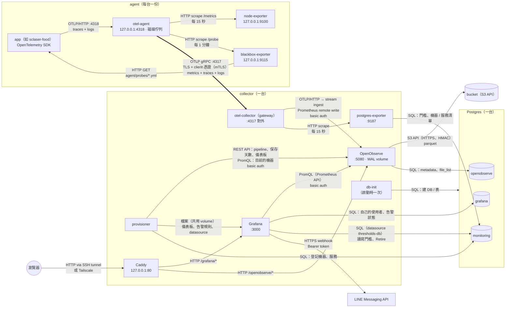

# 服務關係圖

這一頁只畫**服務之間的關係和連線方式**（誰連誰、什麼協定、哪個 port、怎麼驗證）。怎麼架設、加機器、簽憑證、更新、排錯等**流程**在 runbook：[collector-runbook.md](collector-runbook.md)、[agent-runbook.md](agent-runbook.md)。角色用詞見 [README 的「角色與用詞」](../README.md#角色與用詞)。

- **agent**（被收集端，任意台）：只跑 `agent/`。
- **collector**（收集端，一台）：跑整套服務（`docker-compose.prod.yml`）。
- 外部服務：bucket（S3 API）、Postgres（一台，三個 DB）、LINE。local 模式下 bucket（RustFS）和 Postgres 是 collector 上的容器（`docker-compose.local-storage.yml`），其他完全相同。
- 方向只有 agent → collector（純 push）：collector 從不主動連 agent。

## 連線一覽

| 從 | 到 | 方式 | 驗證 | 內容 |
|---|---|---|---|---|
| app | otel-agent | OTLP/HTTP `:4318`（主機上的 app：`127.0.0.1`；Docker 裡的 app：docker0 位址 / `host.docker.internal`） | 無（只聽本機） | traces、logs |
| otel-agent | node-exporter | HTTP scrape `/metrics`，每 15 秒 | 無（只聽本機） | 機器指標 |
| otel-agent | blackbox-exporter | HTTP scrape `/probe?module=http_200&target=…`，每 1 分鐘 | 無（只聽本機） | 探測結果 `probe_success` 等 |
| blackbox-exporter | app | HTTP GET（`agent/probes/*.yml` 的 URL） | 無 | 只有 200 算 UP |
| otel-agent | gateway | **OTLP gRPC `:4317`** | **mTLS**：agent 出示我們 CA 簽的 client 憑證，並用 CA 驗證 gateway 憑證 | metrics + traces + logs（全部加上機器名稱 `host.name`）；斷線時存在磁碟佇列 |
| gateway | OpenObserve | OTLP/HTTP（`/openobserve/api/default/v1/traces`、`/v1/logs`，寫進 stream `ingest`）、Prometheus remote write | basic auth（root 帳號，只有 gateway 持有） | 資料寫入。OpenObserve 的 pipeline 依 `service.namespace` 把 `ingest` 分流到同名 stream |
| gateway | postgres-exporter | HTTP scrape `:9187`，每 15 秒 | 無（容器網路） | 門檻、機器 / 服務清單 → metrics |
| OpenObserve | bucket | S3 API（HTTPS） | HMAC key | parquet 資料檔 |
| OpenObserve | Postgres `openobserve` | SQL | 帳密（`PG_*`） | schema、file_list、使用者、儀表板 |
| Grafana | OpenObserve | Prometheus 相容 API（PromQL） | basic auth | 儀表板、告警規則的資料 |
| Grafana | Postgres `grafana` | SQL | 帳密 | Grafana 自己的使用者、告警狀態 |
| Grafana | Postgres `monitoring` | SQL（datasource `thresholds-db`） | 帳密 | Fleet Overview 讀寫門檻、Retire 刪機器 / 服務 |
| Grafana | LINE | HTTPS webhook（`api.line.me/v2/bot/message/push`） | Bearer token（`LINE_CHANNEL_ACCESS_TOKEN`） | 告警、彙整 |
| provisioner | OpenObserve | REST API + PromQL | basic auth | 維持分流 pipeline、設定保存天數、同步 API Service 儀表板；查目前送資料的機器、有探測結果的服務 |
| provisioner | Postgres `monitoring` | SQL | 帳密 | 登記機器、服務（機器 / 服務清單） |
| provisioner | Grafana | 檔案：共用 volume `grafana-provisioning` | – | 儀表板（Grafana 每 30 秒讀）、告警規則、datasource（啟動時讀） |
| db-init | Postgres | SQL，每次啟動跑一次 | 帳密 | 建立缺少的 DB 和表 |
| 瀏覽器 | Caddy | HTTP `127.0.0.1:80`，經 SSH tunnel 或 Tailscale | Grafana / OpenObserve 各自的登入 | 網頁 |
| Caddy | Grafana / OpenObserve | HTTP 反向代理，依路徑 `/grafana/*`、`/openobserve/*` | – | 網頁；Grafana 儀表板上的 OpenObserve 連結是相對路徑，同樣經過 Caddy |

collector 上只有 gateway 的 4317 對外開放，其餘都只綁 127.0.0.1 或只在容器網路裡。
