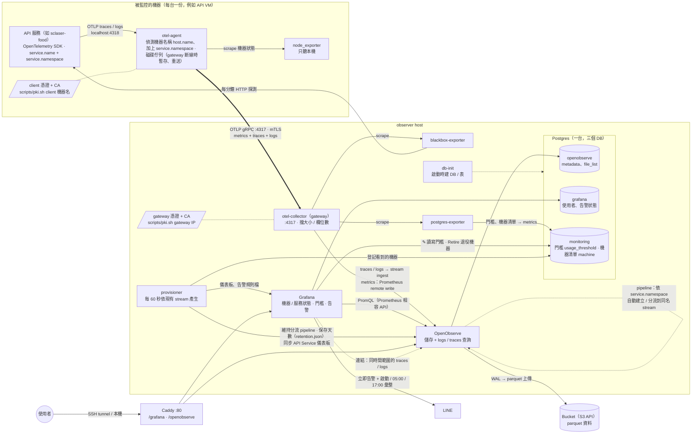

# 服務關係圖

兩種角色的主機：
- **被監控的機器**（API VM，這台 Mac 也算一台）：每台跑一個 agent。app 的 traces / logs 和 node_exporter 的機器狀態都只送到本機的 agent，由 agent 統一推到 observer。
- **observer host**：唯一入口是 gateway（:4317，OTLP gRPC + mTLS，只接受我們 CA 簽發的 client 憑證）。新增機器不用改 observer。

local 和 prod 是同一套設計、同類型的服務，只差在 Bucket 和 Postgres 由誰提供（local：RustFS / Postgres 容器；prod：GCS / Cloud SQL 等），由 env 決定（`.local.env` / `.prod.env`），分別用 `docker-compose.local.yml` / `docker-compose.prod.yml` 啟動。

